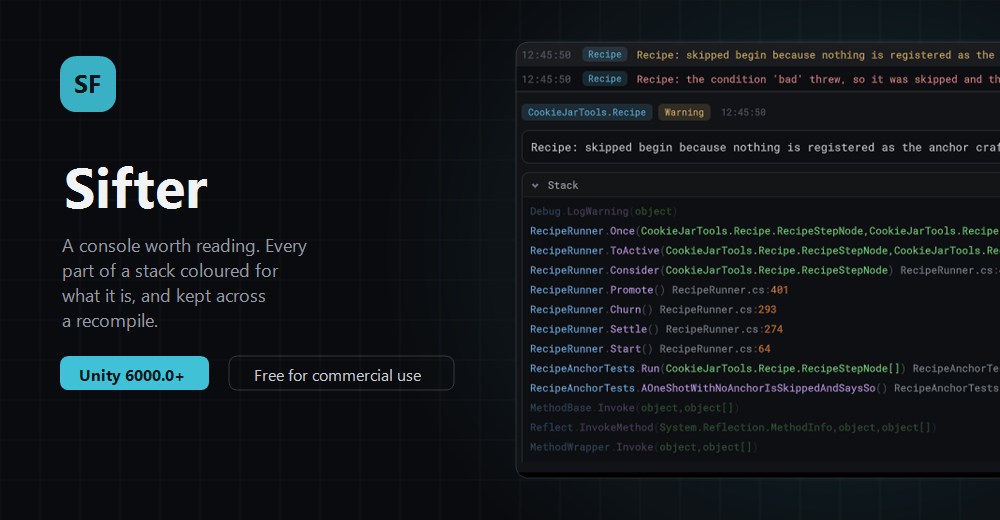

<p align="center">
  
</p>

<h3 align="center">A console for the Unity editor worth reading. Every part of a stack trace coloured for what it is, categories nobody had to declare, and a list that survives a recompile.</h3>

Open it from **Window > CookieJarTools > Sifter**.

## Install

Unity 6000.0 or newer.

**In the Package Manager**

1. Open `Window > Package Manager`
2. Press **+**, then **Install package from git URL**
3. Paste this and press Add:

```
https://github.com/CookieJarTools/Sifter.git
```

**Or by hand**, put this line in `Packages/manifest.json`:

```json
"com.cookiejartools.sifter": "https://github.com/CookieJarTools/Sifter.git"
```

## What it does

**A stack trace you can read at a glance.** A stack is the most structured thing in the editor and
Unity draws every part of it the same grey. Here the namespace, the class, the method, the
parameters, the file and the line each have their own colour, and each can be turned off on its
own. Turning off namespaces and parameters alone takes most traces from two lines to one.

**Clicking any frame opens that file at that line**, not only the one that called `Debug.Log`. The
line you want is almost never the line that logged.

**What the compiler generated is turned back into what you wrote.** A lambda arrives as
`<Resolve>b__0` on a class called `<>c__DisplayClass18_0`, and an async body as `MoveNext` on a
class called `<Resolve>d__12`. Both are shown as `Resolve`, with the raw line in the tip.

**Categories without declaring any.** A log starting `[Combat]` joins the Combat category. Anything
else is named after the namespace of the first frame of your own code, two parts deep by default,
so `CookieJarTools.Sifter.Editor` becomes `CookieJarTools.Sifter`. They form a tree you can switch
on and off a branch at a time, and each gets a colour of its own. Nothing in your game references
this package, and there is no attribute to add: everything already written is categorised the day
you install it.

**The list survives a recompile**, which is exactly when you most want to compare what happened
before a change with what happens after, and exactly when Unity's console throws everything away.
Entering play mode and closing the editor are kept too, by choice.

**Your own code, or everything.** My Code Only folds away every frame that is not under `Assets`,
and `[HideInCallstack]` is honoured, which matters the moment anybody wraps `Debug.Log` in a helper
of their own.

**Settings with a sample of what the settings do.** Nearly everything in here is about how something
reads, and a sentence describing a colour or a row height is no use next to seeing it. The sample is
drawn with the console's own row and the console's own painter, so it cannot drift from the real
thing.

## Worth knowing

**It cannot fully replace Unity's console.** The profiler window and some of the editor's own double
clicks open the built-in one regardless, and nothing a package can do changes that.

**Compile errors come from `CompilationPipeline`**, and what was on screen before Sifter loaded is
read once from Unity's own console backend, which is undocumented. If a Unity version moves it, the
window says so in place of going quiet, and everything except that one backfill carries on working.

**Logs are held in a ring buffer**, five thousand by default, written to `Library` on the way out of
a domain and read back on the way in. It is a cache: losing it costs nothing, and it is already
outside version control. A very long stack is cut short rather than making every reload slow.

**Docked in a corner**, turn on Compact in the settings and move the log pane beside the list rather
than under it. Down the side of the editor there is height and no width, and a stack that has to
wrap every line is hard to read.

## Licence

PolyForm Shield 1.0.0. Use it for anything you like, including in a game you sell. The one thing you
may not do is use it to provide a product that competes with the tool itself.
